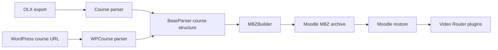

# Architecture

The converter uses one intermediate course structure for both input sources. This keeps Moodle MBZ generation
independent of the source format.

## Parser contract

`BaseParser` provides the shared structure used by `MBZBuilder`. Parsers populate chapters, subsections, page
components, static files, readings, and video metadata. `MBZBuilder` does not branch on whether the source was OLX
or WordPress.

## Source specific behaviour

The OLX parser reads local XML and static assets. The WordPress parser fetches public HTML pages and can download
linked PDFs. Both normalise their result into the same structure before conversion.

## Foreign host checks

Links to hosts the converted course must not depend on are handled in five places. Each has its own host list on
purpose, because each answers a different question.

| Job | Code | Hosts |
| --- | --- | --- |
| Bundle the file locally | `olx.py` `_DELFTX_FILE_RE`, `wp.py` through `AssetFetcher` | DelftX pdf / mp3 / DaCG (OLX), edX hosts and OCW uploads (WP) |
| Strip markup | `olx.py` `_PLATFORM_JUNK_RES` | DelftX and edX loaders and buttons, OLX only |
| Unwrap the link | `converter/html.py` `_PLATFORM_LINK_RE` (MBZ), `ZipBuilder._relink` (zip) | edX domains and delftxtools (MBZ), `is_dead_host` (zip) |
| Warn at parse time | `utils.py` `_EDX_HOST_RE`, `_WP_HOST_RE` | edX content hosts, ocw.tudelft.nl (WP MBZ only) |
| Audit the result | `url_audit.py` | `is_platform_host`, plus `is_ocw_host` for the zip |

The shared code live in `ocw/utils.py`: `EDX_DOMAINS` (used by `PLATFORM_HOST_RE` and `_PLATFORM_LINK_RE`), and the
`hostname`, `is_ocw_host`, `is_platform_host` and `is_dead_host` helpers. The zip decides what is dead through
`is_dead_host`, and the audit checks the same hosts through the other two.

The parse time warning (`_EDX_HOST_RE`) and the audit (`PLATFORM_HOST_RE`) share `EDX_DOMAINS`. They differ in two ways:

* Only the audit knows the delftx hosts (DelftX downloads and tools). The warning leaves them out because the download
  widget keeps its delftxdownloads Video / Subtitles links on purpose, and would warn on every widget.
* Only the warning skips `www.edx.org`. That is edX's marketing site, so a link to it is generic and not content
  hosted on edX (it is still dropped from the final MBZ export).

## Output

`MBZBuilder` creates a Moodle backup archive containing course XML, sections, activities, files, and plugin data.
The optional Video Router data lets Moodle resolve `[[vid:KEY]]` placeholders after restore.
